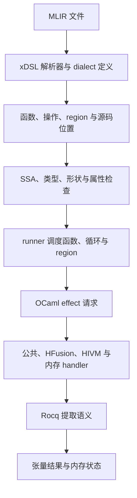

# Attention CPU 解释器设计

本文说明两份归档 attention IR 如何经过 OCaml effect handler，调用 Rocq 提取语义，在 CPU 上计算结果。当前采用 `host-float64` 模型，目的是验证解释架构和计算逻辑，暂不模拟 f16/f32 精度。

## 1. 从一次执行理解整体结构



操作名称、SSA 操作数、维度、循环边界和 reduction region 都来自输入文件。独立数学参考实现负责比较结果。

两份入口分别是 [HFusion IR](../artifacts/flash_attention/ir/hfusion_level.mlir) 和 [HIVM compute IR](../artifacts/flash_attention/ir/attention_hivm_compute.mlir)。本文所称 HFusion 阶段包含 `linalg`、`hfusion` 和公共 dialect；并非所有操作都带 `hfusion.` 前缀。

[混合 attention 示例](../examples/attention_mixed.mlir) 在同一个函数中交替使用 HFusion 和 HIVM 原语。该文件根据归档 HFusion 输入手工编写，用于检查跨阶段 SSA 数据传递和共享内存。

## 2. 语义如何分层

### 原语结构与标量计算

Rocq 决定张量的遍历方式、广播、归约、矩阵乘法、初始化和内存访问；OCaml 数值接口提供每一步标量加减乘除、exp/log 等运算。

| 职责 | 定义与入口 |
| --- | --- |
| HFusion 二元运算、操作数扩展 | [ElemwiseBinary.v](../rocq/HFusion/Semantics/ElemwiseBinary.v) |
| HFusion reduction，执行输入的 combiner | [Reduce.v](../rocq/HFusion/Semantics/Reduce.v) |
| HFusion cast 属性传递 | [Cast.v](../rocq/HFusion/Semantics/Cast.v) |
| HFusion fill、transpose、broadcast、unary、matmul | [Structured.v](../rocq/HFusion/Semantics/Structured.v) |
| HIVM 广播、keep-dim reduction、cast、mmad 等 | [Semantics.v](../rocq/HIVM/Semantics.v) |
| 固定位宽整数运算和转换 | [Arith.v](../rocq/HIVM/Arith.v) |
| 共享矩阵顺序遍历 | [Matrix.v](../rocq/Tensor/Matrix.v) |
| 主机数值接口 | [numeric.ml](../attention/numeric.ml) |

HFusion reduction 从 `outs` 的原有值开始，输出删除被归约维度；实际 combiner 来自 region。HIVM reduction 从操作的 identity 开始，输出保留大小为 1 的被归约维度。二者不能用同一个“忽略初值”的归约替代。

HFusion matmul 读取并累加目标张量。HIVM `mmadL1` 根据 `init` 决定清零还是读取目标，并保留 `b_transpose`。归档 compute IR 中 M/K/N 的零值是该 lowering 阶段的占位参数，不代表零维矩阵。

### float64 约定

运行值使用 OCaml `float`。f16/f32 类型标签继续保留，类型不匹配仍然是错误；浮点 cast 不舍入数值。exp/log 使用主机数学库，矩阵内积按顺序做乘法与加法。

HFusion 的 `arith.maxnumf` 在一个输入为 NaN 时选择另一个输入；HIVM max 传播 NaN。这是操作的语义差别，与是否模拟低精度是不同的问题。

完整 attention 验证使用主机浮点计算，并与独立数学参考实现比较。

### 张量、视图和未初始化值

`EmptyTensor` 只有形状和类型，没有可读取的元素。fill 等完全覆盖目标的操作无需读取旧目标；累加 matmul 必须读取合法初值。非法读取会失败。

`MemRefBackedTensor` 保留 descriptor，消费时才通过内存语义读取。descriptor 指向 allocation，并携带 offset、sizes 和 strides。多个 descriptor 可以表示同一 allocation 的不同视图。

这部分定义见 [Value.v](../rocq/HIVM/Value.v)、[Runtime.v](../rocq/HFusion/Runtime.v)、[Memory/Model.v](../rocq/Memory/Model.v) 和 [内存原语语义](../rocq/HFusion/Semantics/Memory.v)。

### lens 与状态提交

运行状态包括内存和独立字段。handler 将内存 lens 传入提取的 `run_memory`，由 `zoom` 聚焦内存组件。调用成功才替换当前状态；错误不提交中间写入。它既检查外层内存错误，也检查内层复合操作的失败结果。

[Execution.v](../rocq/HIVM/Execution.v) 中的 `run_memory_preserves_independent` 是独立组件保持不变的通用证明。[handlers.ml](../attention/handlers.ml) 提供具体 lens。运行保留 `marker = 73`，测试另外检查失败操作不会替换状态。

内存底层使用 Rocq 列表模型。尾递归 `handle_memory_tail` 在递归执行过程中释放旧状态；[Handler.v](../rocq/Memory/Handler.v) 的 `handle_memory_tail_correct` 证明它与原 handler 在相同 fuel 下给出相同结果、状态及事件顺序。

## 3. Effect handler 的职责

[handlers.ml](../attention/handlers.ml) 定义四类请求：

| 请求 | 内容与处理 |
| --- | --- |
| `Common` | tensor.empty、reshape、整数与浮点标量原语，调用相应提取函数 |
| `HFusion` | 已求值的 HFusion 原语参数，调用 `sem_linalg_*` 或 `sem_hfusion_cast` |
| `HIVM` | 已求值的 HIVM request，调用提取的 `evaluate` |
| `Memory` | 提取语义构造的内存 computation，调用 `run_memory` |

runner 负责查找 SSA 值并发出请求。handler 不重新解析 MLIR，也不实现另一套矩阵乘法。输入到结果的适配会检查形状，避免利用提取后被擦除的依赖类型证明接受非法值。

缺少 handler 会产生未处理 effect，不存在自动回退到旧 H1–H5 手写计算的路径。原有演示解释器继续独立使用。

HFusion reduction 有一个特殊调用路径：提取的归约函数调用 OCaml combiner，combiner 再执行真实 region。回调重新安装公共和内存 handler；region 中的每个操作依据自己的阶段标记安装计算 handler。内部 `arith.maxnumf`/`arith.addf` 使用公共 handler。

错误通过异常退出到带源码位置的 runner。内存错误不会被当作成功；trace 的 `entry` 字段标出实际提取入口。

## 4. 解析与解释执行

### xDSL 前端与源码位置

[attention_frontend.py](../scripts/attention_frontend.py) 使用固定版本 `xdsl==0.74.0` 解析整个 MLIR module，并调用 `module.verify()`。公共 dialect 使用 xDSL 定义；[attention_dialects.py](../scripts/attention_dialects.py) 用 IRDL 和声明式 `assembly_format` 描述归档版本中的 HFusion/HIVM 操作及相关公共操作格式。词法、类型、属性、SSA 和 region 语法由 xDSL 处理。

前端在 xDSL 的操作解析和 SSA 注册入口记录源码名称与位置，随后输出 JSON：函数参数、操作数及其类型、结果类型、属性、region、region 参数和源码范围。[parser.ml](../attention/parser.ml) 通过子进程调用前端，用 Yojson 解码为 OCaml 类型化 AST。[source.ml](../attention/source.ml) 保存文件名、偏移和行列，供验证与执行错误定位。位置记录不改变操作语义。

可执行操作限定为两份归档文件的子集。设备元信息由 xDSL 作为 opaque attribute 读取；CPU 执行只使用函数体及参数。未支持的执行操作、属性、类型和 region 形式直接报错。前端依赖位于仓库的 `.venv-attention`；通过 `ATTENTION_ROOT` 可以指定仓库根目录。

### 逐操作阶段标记与混合执行

[stage.ml](../attention/stage.ml) 定义 `Common | HFusion | HIVM`。[parser.ml](../attention/parser.ml) 解码每个操作时根据 opcode 填入 `operation.stage`，递归处理所有 region。`linalg.*` 和 `hfusion.*` 属于 HFusion，`hivm.*` 属于 HIVM；支持范围内的 `arith`、`tensor`、`memref`、`bufferization`、`scf` 和 `func` 操作属于 Common。

阶段标记描述操作的语义归属。公共操作可以出现在任何阶段的程序和 region 内。例如，HFusion `linalg.reduce` 的 region 中，`arith.addf` 标为 Common，`linalg.yield` 标为 HFusion。

`Runner.with_operation_handlers` 根据标记启用当前计算 handler，并保留公共和内存 handler。外层 `with_handlers` 处理公共请求和内存请求。阶段与 opcode 的一致性在验证和执行入口检查；错误标记直接失败。不同阶段共用 SSA 环境中的张量值与同一个内存状态，memory lens 在阶段切换时继续使用。

混合示例中 `%17` 由 HFusion matmul 产生，HIVM vmul 读取它并产生 `%18`，HFusion reduce 再读取 `%18`；后续的 vexp、HFusion cast、vln 和输出 vcast 继续交替使用两个阶段。每个原语仍采用自身的归约、类型和初始化规则。

### SSA、控制流与归约 region

[validate.ml](../attention/validate.ml) 在执行前检查支持的操作、属性、SSA 引用、局部重定义及类型标注。不同 reduction region 可以重复使用 `%38`，因为每个 region 有独立作用域。

[runner.ml](../attention/runner.ml) 保存 SSA 环境，调度函数体和 `scf.for`。循环上界为开区间，步长必须为正；更新 induction variable 调用提取的整数语义。执行预算覆盖循环调度和 region 内操作，防止错误输入无限运行。

OCaml runner 的控制流实现当前没有整体 Rocq 正确性证明。Rocq 提取覆盖原语计算，不应把这两种保证混为一谈。

### program id 与共享内存

固定输入为 batch=head=1、N=D=128、非 causal，Q/K/V/O 各为 128×128，log-sum-exp 为 128 项。这些尺寸已经特化在文件中。

当前 IR 的 query 块循环是 `block = program_id; block < 4; block += 20`：

| program id | 工作 |
| --- | --- |
| 0–3 | 分别处理连续的 32 行 query |
| 4–19 | 空循环 |

CPU 顺序调用这 20 个逻辑实例，共享该阶段的输入和输出内存，每次调用使用独立 SSA 环境。有效实例写入不同输出行。该执行方式验证功能，不验证并发、竞争或硬件同步。

HFusion 和 HIVM 从独立状态开始，使用相同输入，执行完成后比较结果。

## 5. 沿 attention 路径阅读代码

1. [attention.ml](../attention/attention.ml) 准备 Q/K/V、输出 descriptor 和函数参数，将 program id 传给 runner。
2. `memref.reinterpret_cast` 构造当前 query 块的视图；`memref.copy` 复制至局部 allocation；`bufferization.to_tensor` 建立视图。
3. HFusion 先 transpose K，再 matmul；HIVM 用带 `b_transpose` 的 `mmadL1`。两者得到当前 32×128 的分数矩阵。
4. 乘 scale，求每行最大值，广播后相减，再求 exp。HFusion 的 max 来自 reduction region；HIVM 来自 `<max>` 参数。
5. 归约 exp 得到分母；另一次矩阵乘法计算加权 V，再除以分母得到 O。
6. `max + log(sum(exp))` 得到 log-sum-exp。materialize 将两种结果写回全局输出 descriptor。

以 `hivm.hir.vmul` 为例：parser 保存输入和目标的 SSA 名 → runner 查找值并构造 `BinaryRequest VMul` → `HIVM` effect → handler 调用 `evaluate` → `sem_binary` 检查形状、扩展标量并逐元素调用 `number_binary` → 返回新张量 → runner 将其绑定到结果 SSA。

内存写回多一步：`Memory` 请求的 computation 经 `run_memory` 执行，成功后 handler 提交新的内存组件；它不直接修改 OCaml 浮点数组。

## 6. 构建、运行和结果检查

在仓库根目录运行：

```sh
ATTENTION_PYTHON=python3.12 sh scripts/bootstrap_attention.sh
export TMPDIR="$PWD/_build/task-tmp"
opam exec --switch=unified-interpreter -- dune build @all
opam exec --switch=unified-interpreter -- dune exec attention -- \
  --stage both --output reports/attention.json --trace reports/attention.jsonl
opam exec --switch=unified-interpreter -- dune runtest
```

依赖为 Python 3.12 及以上、固定版本 xDSL，以及 OCaml 5、Dune、Rocq、rocq-stdpp、Yojson 和 Zarith。[requirements-attention.txt](../requirements-attention.txt) 固定 Python 依赖版本，[unified_interpreter.opam](../unified_interpreter.opam) 声明 OCaml/Rocq 依赖。安装脚本创建独立 Python 环境和仓库内的构建临时目录；OCaml/Rocq 使用 `unified-interpreter` opam switch。

`ATTENTION_PYTHON` 可以设置为 Python 3.12 解释器的完整路径。生成结果与 trace 后，执行 `.venv-attention/bin/python -B scripts/check_attention_output.py` 检查输出形状、参考比较、program id 覆盖和调用计数。

[构建脚本](../scripts/build_extraction.sh) 将 `_CoqProject` 列出的源码复制到 Dune 构建目录，调用 Rocq 编译和提取。[提取声明](../rocq/Extraction/Extract.v) 选择导出接口。生成代码不手工修改，也不依赖源目录残留 `.vo` 或 `.cmo`。

不提供输入文件时，生成固定种子的有限输入，scale 为 `1/sqrt(128)`。`--input` 接收 JSON 对象，字段 `Q`、`K`、`V` 均为 128 行、每行 128 个数；可选 `scale` 为有限数。非有限输入和错误形状被拒绝。

`--stage` 可选 hfusion、hivm、mixed、both。hfusion/hivm 检查单阶段输入，both 分别运行两份归档输入；mixed 在一份文件中接受两类计算操作，并要求提供 `--ir`。`--max-steps` 默认 1000000。输出 JSON 包含 O、log-sum-exp、配置、调用统计及与参考结果的误差。

```sh
opam exec --switch=unified-interpreter -- dune exec attention -- \
  --stage mixed --ir examples/attention_mixed.mlir \
  --output reports/attention-mixed.json --trace reports/attention-mixed.jsonl
.venv-attention/bin/python -B scripts/check_attention_mixed_output.py
```

trace 为 JSONL：`stage` 记录本次输入的执行模式，`ir_stage` 记录当前操作的语义阶段，另有 program_id、循环变量及迭代值、文件行列、opcode、结果 SSA 和 entry。输入准备及最终结果读取属于宿主操作，`ir_stage` 为 null。HFusion 操作读取 memref 张量时也会请求 Memory handler，因此实际调用入口需结合 `entry` 阅读。

例如，可按 `program_id = 0`、`opcode = "hivm.hir.vmul"` 筛选 trace，
再沿 `file`/`line` 找回源操作。其 `entry = "HIVM.evaluate"` 对应
提取的 dispatcher，进一步分派到 `sem_binary`；`loops` 中的
`%arg16 = 0` 表明当前处理第一个 query 块。

完整测试包含固定种子、零 Q/K 和常量矩阵，并执行[使用 vadd 的 MLIR 测试文件](../attention_test/fixtures/attention_hivm_vadd.mlir)，
检查末尾除法变为加法后输出和 trace 确实改变。测试用例之间使用独立 OCaml domain 并行运行，
每个用例内部仍顺序执行 20 个 program。列表内存模型优先保留可检查的语义，
全尺寸测试可能需要数分钟。

独立参考实现直接计算稳定 softmax attention，不调用提取语义。比较采用 `atol=1e-10`、`rtol=1e-9`，非有限结果不能通过。通过比较支持当前输入上的功能一致性，不构成 lowering 保持语义的证明。

## 7. 核查入口与边界

先读 [attention.ml](../attention/attention.ml)，再读 [runner.ml](../attention/runner.ml)、[handlers.ml](../attention/handlers.ml)，最后沿调用进入上面的 Rocq 语义文件。

测试位于 [attention_test](../attention_test)：parser 测试检查原始文件和嵌套位置；handler 测试检查提取调用、缺失 handler、NaN 区别及内存失败原子性；完整执行测试与独立数学参考比较。

[mixed_test.ml](../attention_test/mixed_test.ml) 检查阶段标记、单阶段拒绝混合输入、错误标记拒绝、计算 handler 的选择、循环中的跨阶段数据传递、归约回调和共享内存。[mixed_execution_test.ml](../attention_test/mixed_execution_test.ml) 对完整混合 attention 比较独立参考，并检查同一次执行中两个计算 handler 的实际调用。

官方出处、已有模型限制及语义审查问题见 [语义审查报告](semantics-audit-report.md) 和 [HIVM 语义范围说明](hivm-compute-semantics.md)。本次工作不消除其中所有已知差异。当前交付不包含真实 f16/f32 精度、NPU 数值一致性、异步执行或完整程序正确性证明。

## 8. 实际验证记录

2026-10-24，混合执行验证：

- 小规模混合程序计算得到 `[26; 26]`，覆盖循环、HFusion/HIVM 数据传递、HFusion 归约 region、内存写入与后续读取。
- 错误阶段标记在执行前被拒绝；当前操作未启用的计算 handler 请求产生未处理 effect。
- 完整混合 attention 的测试与 CLI 执行均通过独立参考比较，O 和 log-sum-exp 的最大绝对误差均为 0。
- CLI 结果与 JSONL trace 检查通过，包含 20 个 program、逐操作阶段和实际计算入口；仅 program 0–3 执行内存复制。
- 完整 `dune runtest` 通过；原有三组输入在 HFusion、HIVM 两个阶段的 O 和 log-sum-exp 参考误差仍均为 0。

2026-10-22，使用 `unified-interpreter` opam switch 和 xDSL 0.74.0：

- Dune 调用 Rocq 编译 `_CoqProject` 中的源码并重新提取 OCaml 接口，
  包括尾递归内存 handler 等价性证明与泛化的矩阵/结构操作示例。
- 在新的构建目录执行 `dune build @all`，从源码重新生成提取库并成功链接 CLI。
- 两阶段 CLI 对默认固定种子输入均输出完整结果；O 和 log-sum-exp 的最大绝对
  参考误差及阶段间误差均为 0。
- 实际 JSON 输出通过形状检查；trace 包含 program id 0–19，
  仅 0–3 发出 `sem_memref_copy`。
- 固定种子、零 Q/K、常量矩阵三组全尺寸输入在两个阶段的 O 和
  log-sum-exp 参考误差均为 0，阶段间比较也通过。vadd 测试文件的
  `%37` 操作被 trace 捕获，并使输出无法通过原 attention 参考比较。
- parser/handler 测试覆盖源码位置、循环上下文、非法 SSA/属性/类型、预算耗尽、
  单独移除每类 handler、NaN 区别、未初始化读取、越界、非法 cast，
  以及已发生中间写入后失败仍不提交状态。

默认运行的部分可核查数值为：

| 项目 | HFusion 与 HIVM |
| --- | --- |
| O[0,0] | 0.004908662752173827 |
| O[0,1] | 0.009642254849480501 |
| O[0,2] | -0.01908627263671899 |
| log-sum-exp[0] | 4.853369805731775 |

这些数值来自当前主机 float64 模型及固定输入。
